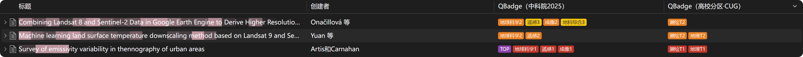

  

  
  

  
  
  

# QBadge

Show CAS journal quartiles and university journal tiers directly in Zotero's item list.

## Features

- **Two independent columns**: `QBadge（中科院2025）` and `QBadge（高校分区）`
- **CAS partition**: major category / minor categories / TOP, 1–4 quartile colors; minor categories are selectable and reorderable
- **University partition** (currently CUG only, using CUG as the example): T1–T6 by discipline; T1–T4 use the same colors as CAS, T5/T6 use separate colors
- **Fully offline**: data is bundled; no network, no upload, no API key
- **Cross-platform**: Windows / macOS / Linux

> The university column currently supports **China University of Geosciences (Wuhan)** only. Other universities are not supported yet. If you want your school's catalog added, please open an Issue with the school name and catalog file.

## Installation

1. Download the latest `.xpi`: [Releases](../../releases/latest)
2. Zotero → Tools → Plugins → gear icon → Install Plugin From File…
3. Select the `.xpi` and restart Zotero
4. Right-click the item list header and enable `QBadge（中科院2025）` and `QBadge（高校分区）`

> New columns are hidden by default and must be enabled once from the header context menu.

## Usage

Edit → Settings → QBadge:

### CAS partition

- Display: major + minor / major only / minor only
- TOP tag toggle and position
- Major/minor tag order
- Filter minor categories by major category
- Multi-select and numbered reorder (↑ / ↓ / ×)

### University partition

- University: currently only China University of Geosciences (Wuhan)
- Discipline multi-select (defaults: Surveying and Mapping, Geography)
- Numbered reorder (↑ / ↓ / ×)

## Colors

| Tier | Color | Swatch |
|:---:|:---:|:---:|
| TOP | `#8E44AD` |  |
| CAS Q1 / CUG T1 | `#C0392B` |  |
| CAS Q2 / CUG T2 | `#E67E22` |  |
| CAS Q3 / CUG T3 | `#F1C40F` |  |
| CAS Q4 / CUG T4 | `#7F8C8D` |  |
| CUG T5 | `#2E86C1` |  |
| CUG T6 | `#85C1E9` |  |

- CAS Q1–Q4 and CUG T1–T4 share the same palette; TOP is purple.
- CUG T5 and T6 use blue.

## Data

| Data | Version | Coverage |
|:---:|:---:|:---:|
| CAS Journal Ranking (中科院期刊分区表) | 2025 (final official edition) | 21,772 journals |
| CUG journal catalog | 2023 | 9,922 journals, 38 disciplines |

- The CAS table stopped updating in 2026; 2025 is the final edition.
- The CUG catalog is organized by discipline with T1–T6 levels; a journal may belong to multiple disciplines with different levels.
- The CUG catalog has no ISSN; matching uses ISSN mapping plus English/Chinese journal names.
- Unmatched journals are left blank (hover shows "not listed"); conference papers are not displayed.

## More universities

The university column currently bundles only the 2023 CUG catalog. Other schools are not supported yet.

To add your school, open an Issue with:

- School name
- Catalog name and version year
- Catalog file (Excel / PDF)
- Discipline and level definitions (e.g. T1–T5, A/B/C)

## Compatibility

- Zotero 8 / 9 / 10 / 11
- Windows / macOS / Linux
- **Zotero 7 and earlier are not supported**

## FAQ

- **The columns don't appear.**
  Right-click the item list header and enable them.

- **A journal has no badges.**
  It may not be in the corresponding catalog. The university column supports Chinese journal names; the CAS table covers English journals only.

- **Why is TGRS a Q2 in the CAS minor category?**
  CAS major and minor categories use different algorithms. TGRS is Q1 Top in Geosciences (major) but Q2 in Remote Sensing (minor).

- **Why does MDPI's Remote Sensing have no CUG Geography tier?**
  In the 2023 CUG catalog, it appears only under Surveying and Mapping, Information and Communication Engineering, Geo-information, and Safety Science — not Geography.

- **Zotero says the plugin is unsigned.**
  This is normal for local installation; continue the installation.

## Privacy

The plugin runs fully offline and does not collect or transmit any data.

## Feedback

Please use [Issues](../../issues) and include your Zotero version, OS, and a screenshot.

## License

QBadge is closed-source software. This repository provides only the installer and documentation; no source code is included.

- Free for personal, non-commercial use; sharing the unmodified original installer is allowed.
- Decompiling, modifying, redistributing modified versions, or commercial use is prohibited.
- Journal classification data belongs to the original institutions and is provided for personal reference only. It will be removed upon a rights holder's request.

## Acknowledgements

- CAS National Science Library journal ranking
- China University of Geosciences (Wuhan) journal catalog
- The Zotero plugin community
